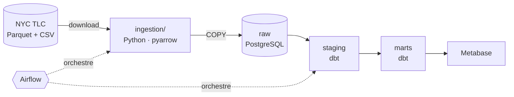

# ⚙️ Local Data Platform

> Une stack data moderne complète qui tourne sur un laptop : ingestion → entrepôt → transformation → BI, orchestrée et reproductible avec une seule commande.


## 📊 Problématique

Apprendre la data engineering demande de pratiquer avec les outils du marché, mais monter une
infrastructure complète (ingestion, entrepôt, transformation, orchestration, BI) est souvent
coûteux et dépendant du cloud.

**Objectif** : une plateforme complète, **100 % locale**, lancée par `docker compose up`,
appliquée à un vrai jeu de données volumineux — les trajets des taxis jaunes de New York
(~3 millions de lignes par mois).

## 🏗️ Architecture



| Couche | Outil | Rôle |
|---|---|---|
| Orchestration | **Apache Airflow 3** (LocalExecutor) | DAG `nyc_taxi_pipeline` : download → load → `dbt build` |
| Ingestion | **Python** (pyarrow, pandas, psycopg 3) | Lecture Parquet par lots, chargement `COPY`, idempotent par mois |
| Entrepôt | **PostgreSQL 17** | Schémas `raw` → `staging` → `marts` |
| Transformation | **dbt** (dbt-postgres) | Modèles staging + marts, seeds, tests de qualité |
| BI | **Metabase** | Dashboards sur les marts |
| Infra | **Docker Compose** | Toute la stack en une commande |

## 🗂️ Données

- **Trajets** : [NYC TLC Trip Record Data](https://www.nyc.gov/site/tlc/about/tlc-trip-record-data.page) — taxis jaunes, un fichier Parquet par mois (~50 Mo, ~3 M lignes)
- **Zones** : table de correspondance des 265 zones de taxi
- **Référentiels** (seeds dbt) : types de paiement, fournisseurs

## 🚀 Démarrage

Prérequis : Docker Desktop avec **au moins 6 Go de RAM** alloués (Airflow + Metabase + Postgres).

```bash
cp .env.example .env          # optionnel (sous Linux : AIRFLOW_UID=$(id -u))
docker compose up -d --build  # ou : make up
```

| Service | URL | Identifiants |
|---|---|---|
| Airflow | http://localhost:8080 | `airflow` / `airflow` |
| Metabase | http://localhost:3000 | à créer au premier lancement |
| PostgreSQL | `localhost:5433` | `warehouse` / `warehouse`, base `warehouse` |

Lancer le pipeline pour un mois donné (depuis l'UI Airflow avec *Trigger DAG w/ config*, ou) :

```bash
make run YEAR=2024 MONTH=1
```

Dans Metabase, ajouter une base PostgreSQL : hôte `postgres`, port `5432`, base `warehouse`,
utilisateur `warehouse`, puis explorer le schéma `marts`.

## 🧱 Modélisation dbt

```
raw.yellow_trips ─┐
raw.taxi_zones ───┼─► staging.stg_yellow_trips ─► marts.fct_trips ─┬─► mart_daily_revenue
seeds ────────────┘   staging.stg_taxi_zones ──► marts.dim_zones ──┼─► mart_zone_hourly_demand
                                                                   └─► mart_payment_mix
```

- **staging** : renommage, typage, clé de substitution `trip_id` (fichier source + position), durée de trajet.
- **fct_trips** : trajets valides uniquement — les fichiers TLC contiennent des dates hors période, des durées négatives, des distances aberrantes ; ils sont filtrés ici.
- **marts** : KPIs journaliers (trajets, CA, panier moyen, taux de pourboire, part CB), demande par zone × jour × heure, mix de paiement par mois.

**Tests** : `unique` / `not_null` sur les clés, `relationships` vers les dimensions et seeds,
`accepted_values`, et un test singulier qui réconcilie le mart journalier avec la table de faits.

## 🧪 Qualité & CI

- Ingestion **idempotente** : relancer un mois remplace uniquement ses lignes (`source_file`).
- Gestion de la **dérive de schéma** des fichiers TLC (colonnes ajoutées au fil des ans → `NULL`).
- GitHub Actions : `ruff`, tests `pytest` de l'ingestion, `dbt parse`, validation de `docker-compose.yml`.

```bash
make test   # tests unitaires
make lint
make psql   # shell SQL sur l'entrepôt
```

## 📦 Structure

```
├── dags/                 # DAG Airflow
├── ingestion/            # Téléchargement + chargement dans raw
├── dbt/                  # Projet dbt (staging, marts, seeds, tests)
├── warehouse/init.sql    # Bases, rôles et schémas PostgreSQL
├── docker/airflow/       # Image Airflow + dbt (venv isolé)
├── tests/                # Tests unitaires Python
└── docker-compose.yml    # La stack complète
```

## 📚 Ressources

- [Airflow — Docker Compose](https://airflow.apache.org/docs/apache-airflow/stable/howto/docker-compose/index.html)
- [dbt Docs](https://docs.getdbt.com/)
- [NYC TLC — Data Dictionary](https://www.nyc.gov/assets/tlc/downloads/pdf/data_dictionary_trip_records_yellow.pdf)

Projet inspiré de [pimp-your-portfolio #15 — Modern Data Stack Local](https://github.com/gpenessot/pimp-your-portfolio/tree/main/15-modern-data-stack-local).
